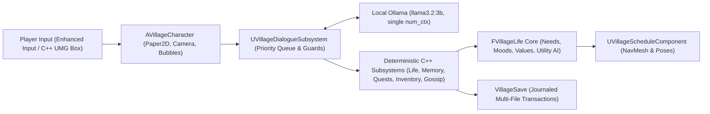
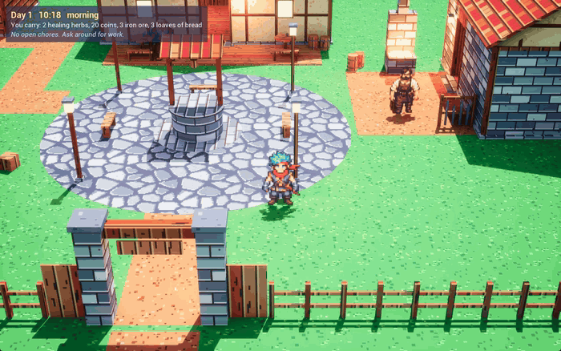

# VillageSim HD-2D (Thornwick)

### A living HD-2D village in Unreal Engine 5 where villagers remember you.

**Active Development · C++ · Unreal Engine 5.8 · Slate/UMG · Paper2D · Python · Ollama**

**VillageSim HD-2D** is a living-village simulation built in Unreal Engine 5 (C++): pixel-art characters in a lit 3D
world, with free-text conversations powered by a local language model (`llama3.2:3b` via Ollama). Villagers have
independent daily routines, needs, moods, values, persistent memories, and gossip—and the **game code owns every state
change**, while the local model only interprets player text and phrases dialogue.

> *The implementation repository is currently private while in active development. Architecture walkthrough and C++ code
> samples are available on request.*

---

## Gameplay Demo

<!-- TODO: Record a 30–60 s manual playtest video (OBS / Win+G) and either:
     1) Drag-and-drop the MP4 directly into GitHub's README editor so GitHub renders an inline video player, OR
     2) Save it as media/gameplay-demo.mp4 and link it below.

     Suggested 45 s take:
     - Walk through the plaza in daytime (show building occlusion fade + stepping inside a building for interior cutaway)
     - Talk to Garrick or Elder Maren in free text (show typewriter text, retro blips/barks, and action buttons)
     - Show evening/night lighting and an overheard NPC speech bubble
-->

> **[Gameplay Video Placeholder — Live Playthrough Coming Soon]**
>
> *Drop a GitHub-hosted video link or `media/gameplay-demo.mp4` here.*

---

## Architecture

The core design rule is **the game decides, the model only phrases**. All trust, inventory, trade, quest, mood, and
schedule transitions run in deterministic C++ subsystems driven by hot-reloadable JSON data; model outputs are
schema-constrained and checked by grounding guards before reaching the UI.

### UE5 & C++ Engineering Highlights

- **Subsystems & World Systems:** Modular `UGameInstanceSubsystem` / `UWorldSubsystem` architecture covering clock,
  life simulation, memory, inventory, quests/trade, gossip, gathering, furniture poses, and interior cutaways.
- **HD-2D Presentation & Rendering:** Paper2D/PaperZD 4-direction flipbooks with per-frame foot pivots in a lit 3D
  world, dynamic material-parameter building occlusion fading (preserving collision/shadows), and enterable building
  roof/wall cutaways.
- **C++ UMG/Slate UI & Procedural Audio:** Dialogue box, HUD, and screen-space speech bubbles built directly in C++
  UMG/Slate, paired with procedurally synthesized 16-bit typewriter blips and per-character voice barks.
- **GPU & Latency Management:** Priority LLM queue (player turns interrupt background gossip/reflection), single context
  window to prevent model reloads (`<= 6 ms` load time), and dynamic `t.MaxFPS` frame-rate capping while the dialogue
  box is open so rendering and local inference share an 8 GB GPU cleanly.
- **Transactional Persistence:** Journaled multi-file save/recovery (`VillageSave`) with automatic rollback/completion
  on interrupted writes.

---

## Measured Performance & Verification

Measured on a Win64 Development build (RTX 5060 Ti, `llama3.2:3b` via local Ollama):

| Metric | Measured Result | Target / Notes |
|---|---:|---|
| **Packaged Win64 Peak VRAM (model loaded)** | **6,329 MiB** | Under **8 GB** GPU target (`3,737 MiB` median unloaded) |
| **Dialogue Turn Latency (judge + reply, real UI box)** | **1.30 s median / 1.46 s p95** | Target `<= 1.5 s` median / `<= 3.0 s` p95 |
| **Automated In-Engine & World Integration Suite** | **165 / 165 passing** | 90/90 PIE checks + 75/75 multi-day world scenarios |
| **Local Model Evaluation** | **4 models · 1,252 turns** | Benchmarked behavioural compliance, latency, and VRAM |

---

## Earlier Development Captures

*Automated continuous-take captures from the development build (before the UI readability and audio pass). Click any
clip for the full 30 fps MP4.*

### Take a job at the forge

Walk up to Garrick and ask for work in your own words. He offers a job to bring iron ore, and accepting it adds the
chore to the village's quest state. [Full capture (MP4)](media/forge-job.mp4)

### After dark at the tavern

Maren and Garrick spend part of the evening on the terrace. As you approach, their conversation appears in speech
bubbles. [Full capture (MP4)](media/tavern-after-dark.mp4)

### A visit after bedtime

Walk into Maren's cottage late at night. The roof cuts away, and you can see her asleep on her bed.
[Full capture (MP4)](media/maren-bedtime.mp4) · [Still frame](media/maren-bedtime.png)

<!-- TODO (optional): Add a second manual clip showing free-text conversation + audio/UI readability
### Free-text conversation & UI
> **[Optional Video Placeholder — Dialogue & Sound]**
-->

---

## Screenshots

Click any image to view it at full resolution.

| A conversation with Garrick | A purchase quote from Maren |
|:---:|:---:|
|  |  |
| **Inside the tavern** | **Evening in the village** |
|  |  |

More stills: [completed purchase](media/trade-complete.png) · [the forge yard](media/forge-yard.png) ·
[building fade](media/building-fade.png).

---

## What Works Today

- **Free-text conversations** with two villagers (Garrick the blacksmith and Elder Maren) via a local LLM.
- **Persistent memories, beliefs, and gossip:** interactions are remembered, reflected on overnight, and shared when
  villagers meet.
- **Autonomous daily lives:** work, meals, sleep, moods, value-driven reactions, and villager-initiated conversations.
- **Core interactions:** gathering, shortages/chores, trust-priced trade, shared activities (guiding, waiting, meals),
  sleep, and journaled saves.
- **HD-2D world & presentation:** live day/night cycle, enterable buildings with interior cutaways, camera-aware
  building fading, readable C++ UI, and retro typewriter/bark audio.

## Current Focus

- **Single C++ simulation core:** retiring the Python test mirror so headless suites run directly against the C++
  `FVillageLife` core.
- **Expanding the village & core loop:** adding the village go-between commission loop (carrying messages and orders
  that the player can relay faithfully or bend) and expanding the cast beyond two villagers.
- **Known prototype limits:** two active villagers today, no public playable release yet, and ongoing work to tighten
  semantic grounding on edge-case replies.
