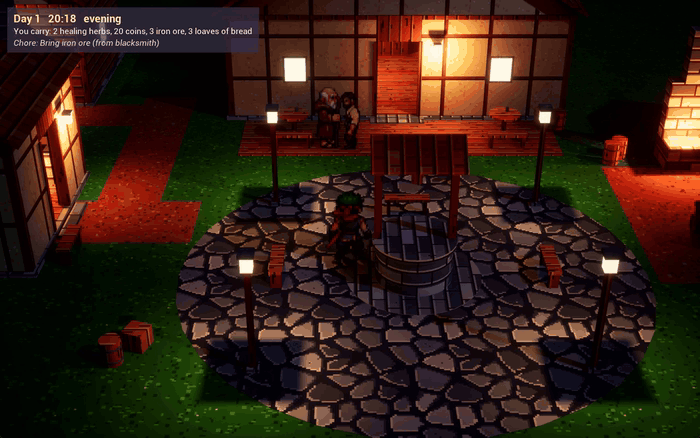
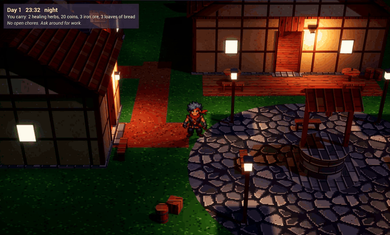
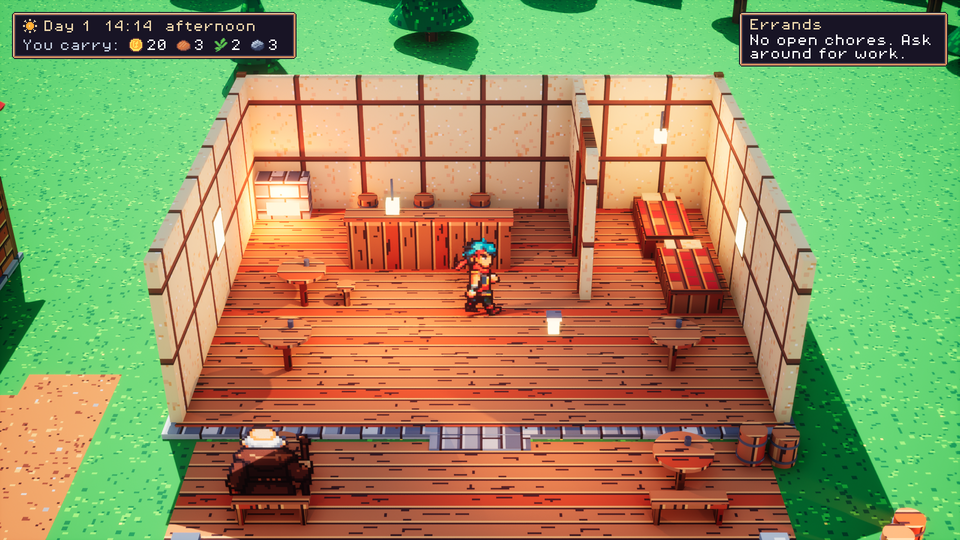
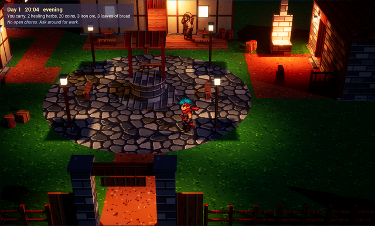

# Thornwick

### A village that remembers you.

**VillageSim** is an HD-2D living-village prototype built in Unreal Engine 5: pixel-art characters in a lit 3D world,
with free-text conversations powered by a local language model.

**In development · C++ · Unreal Engine 5 · Python · Ollama**

Two villagers live here today: Garrick the blacksmith and Elder Maren. Their routines, needs, moods and memories shape
how they respond to the player. The goal is a small village whose people have lives beyond the conversation box.

## Watch the prototype

### Take a job at the forge

Walk up to Garrick and ask for work in your own words. He offers a job to bring iron ore, and accepting it adds the
chore to the village's quest state. [Full capture (MP4)](media/forge-job.mp4)

### After dark at the tavern

Maren and Garrick spend part of the evening on the terrace. As you approach, their conversation appears in speech bubbles.
[Full capture (MP4)](media/tavern-after-dark.mp4)

### A visit after bedtime

Walk into Maren's cottage late at night. The roof cuts away, and you can see her asleep on her bed.
[Full capture (MP4)](media/maren-bedtime.mp4) ? [Still frame](media/maren-bedtime.png)

How these were recorded

Captured from the current development build at normal playback speed. Each clip is a continuous take. A separate
capture save sets the starting hour and position, then input automation walks the player and submits lines through
the game's dialogue UI. NPC actions, dialogue, and lighting come from the running game. The GIFs are excerpts
and the linked 30 fps MP4s show each full take.

## Screenshots

Click an image to view it at full resolution.

| A conversation with Garrick | A purchase quote from Maren |
|:---:|:---:|
|  |  |
| **Inside the tavern** | **Evening in the village** |
|  |  |

More stills: [completed purchase](media/trade-complete.png) · [the forge yard](media/forge-yard.png) ·
[building fade](media/building-fade.png).

## What is working today?

- **Free-text conversations** with two villagers, running through a local model.
- **Persistent memories and gossip:** interactions can be remembered and passed between villagers.
- **Daily lives:** work, meals, sleep, moods and reactions influenced by personality and relationships.
- **Overnight reflection:** villagers form beliefs about the player from their memories.
- **Initiative:** villagers can approach the player, bring up past events and end conversations themselves.
- **A small gameplay loop:** gathering, chores, trade, sleep and persistent saves.
- **Basic shared activities:** villagers can agree to guide the player, share a meal or wait.
- **An HD-2D village:** day/night lighting, enterable buildings, interior cutaways and camera-aware building fades.

## Engineering behind it

**The game owns the state.** Unreal C++ systems control trust, inventory, quests and simulation outcomes. Local language
models interpret player text and phrase responses. Structured outputs and grounding guards constrain replies, but do
not yet catch every semantic mistake.

**Behaviour comes from general rules.** Personality, values, needs, mood and history influence choices. The direction is
greater NPC freedom through an extensible capability interface, with the game validating proposed actions. That broader
interface is still planned; the shared activities shown here are an initial implementation.

**Persistence and evaluation are part of the prototype.** Saves use journaled multi-file transactions with interruption
recovery. Development includes deterministic rule tests, C++/Python parity checks, in-engine UI/regression tests and model
behaviour evaluations. Four local models were compared across 1,252 conversation turns, measuring behaviour, latency and
GPU memory; the smaller baseline was retained because the larger models did not establish an overall quality win.

## What still needs work?

This is an early prototype with **two active villagers**, unfinished art and interaction UI, and no public playable
release yet. Dialogue can still confuse facts, the source of a memory, or promises beyond the NPC's actual abilities.
The existing evaluations also have semantic blind spots.

Current work focuses on keeping dialogue consistent with current world state, making more accepted requests executable,
and evaluating meaning across varied player behaviour. Richer relationships between villagers come after those basics.

## About this repository

This is the public showcase for VillageSim / Thornwick. It contains selected gameplay captures and project notes.
The implementation repository remains private.
