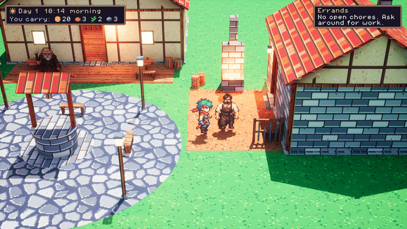
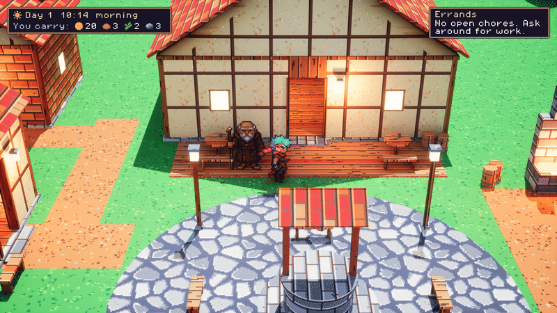
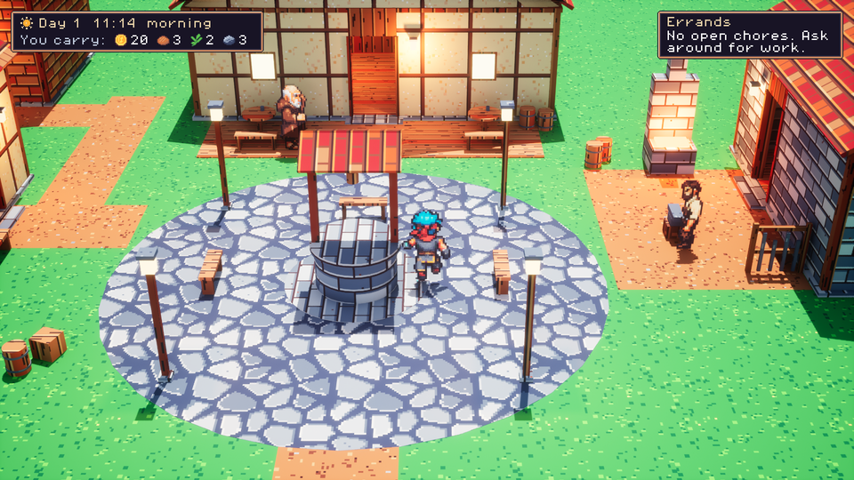
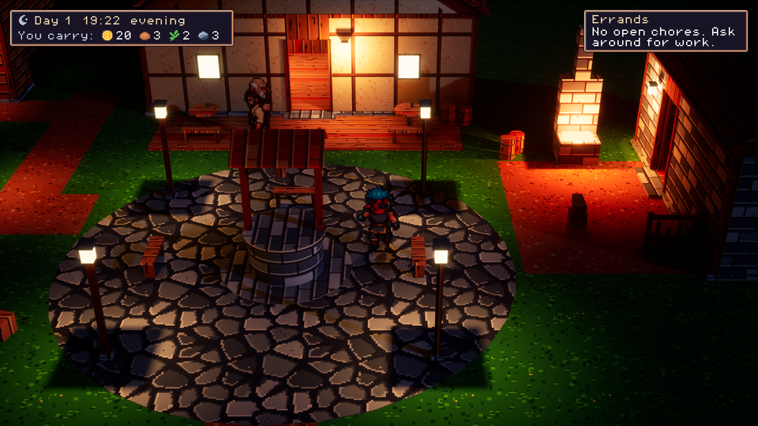
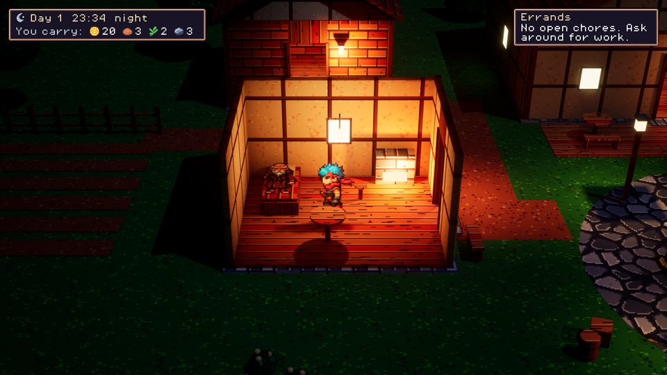
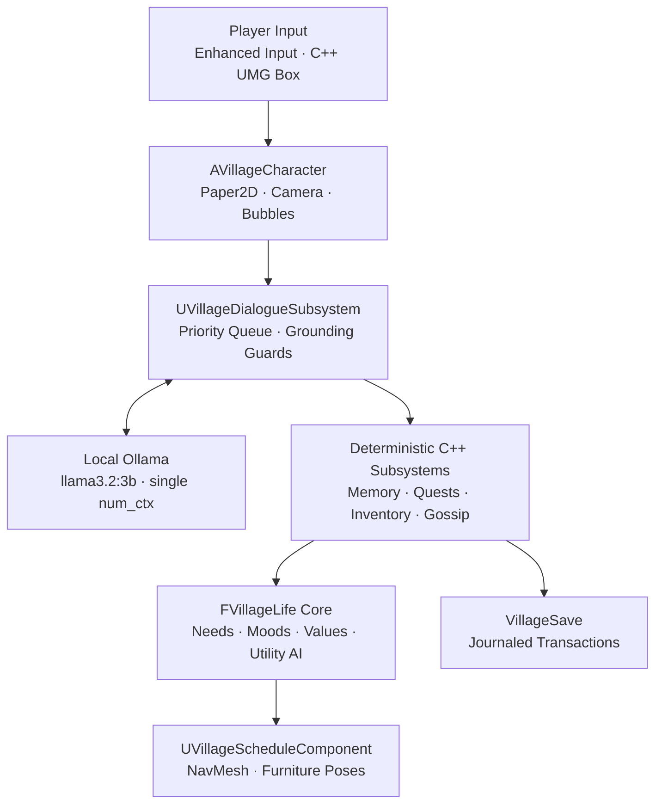

# VillageSim HD-2D (Thornwick)

### A living HD-2D village in Unreal Engine 5 where villagers remember you.

**Active Development · C++ · Unreal Engine 5.8 · Slate/UMG · Paper2D · Python · Ollama**

**VillageSim HD-2D** is a living-village simulation built in Unreal Engine 5 (C++): pixel-art characters in a lit 3D
world, with free-text conversations powered by a local language model (`llama3.2:3b` via Ollama). Villagers have
independent daily routines, needs, moods, values, persistent memories, and gossip—and the **game code owns every state
change**, while the local model only interprets player text and phrases dialogue.

> *The implementation repository is currently private while in active development. Architecture walkthrough and C++ code
> samples are available on request.*

---

## Gameplay Captures

<!-- TODO (optional): Drop a 30–60 s manual video capture (OBS / Win+G) straight into GitHub's README editor when ready. -->

### Free-text conversation at the forge

Ask Garrick about his trade in your own words. Game systems decide what he stocks and cares about while the local
model phrases his reply with typewriter reveal and procedural audio blips/barks.

### Trade list & price quote with Elder Maren

Item panels, quantities, and trust-adjusted price quotes come straight from deterministic C++ trade rules (`Accept` and
`Decline` resolve the transaction without letting the model invent prices).

---

## Screenshots

Click any image to view it at full 1080p resolution.

| Daytime movement in the plaza | Evening walk by lantern light |
|:---:|:---:|
|  |  |
| **Inside the tavern (roof cutaway)** | **Bedtime inside Elder Maren's cottage** |
|  |  |

More 1080p stills: [nighttime square](media/village-night.png) · [camera building fade](media/building-fade.png) ·
[forge conversation](media/conversation.png) · [blacksmith buy list](media/trade-buy.png) ·
[bread price quote](media/trade-quote.png).

---

## Architecture

The core design rule is **the game decides, the model only phrases**. All trust, inventory, trade, quest, mood, and
schedule transitions run in deterministic C++ subsystems driven by hot-reloadable JSON data; model outputs are
schema-constrained and checked by grounding guards before reaching the UI.

### UE5 & C++ Engineering Highlights

- **Subsystems & World Systems:** Modular `UGameInstanceSubsystem` / `UWorldSubsystem` architecture covering clock,
  life simulation, memory, inventory, quests/trade, gossip, gathering, furniture poses, and interior cutaways.
- **HD-2D Presentation & Rendering:** Paper2D/PaperZD 4-direction flipbooks with per-frame foot pivots in a lit 3D
  world, dynamic material-parameter building occlusion fading (preserving collision/shadows), and enterable building
  roof/wall cutaways.
- **C++ UMG/Slate UI & Procedural Audio:** Dialogue box, HUD, and screen-space speech bubbles built directly in C++
  UMG/Slate, paired with procedurally synthesized 16-bit typewriter blips and per-character voice barks.
- **GPU & Latency Management:** Priority LLM queue (player turns interrupt background gossip/reflection), single context
  window to prevent model reloads (`<= 6 ms` load time), and dynamic `t.MaxFPS` frame-rate capping while the dialogue
  box is open so rendering and local inference share an 8 GB GPU cleanly.
- **Transactional Persistence:** Journaled multi-file save/recovery (`VillageSave`) with automatic rollback/completion
  on interrupted writes.

---

## Measured Performance & Verification

Measured on a Win64 Development build (RTX 5060 Ti, `llama3.2:3b` via local Ollama):

| Metric | Measured Result | Target / Notes |
|---|---:|---|
| **Packaged Win64 Peak VRAM (model loaded)** | **6,329 MiB** | Under **8 GB** GPU target (`3,737 MiB` median unloaded) |
| **Dialogue Turn Latency (judge + reply, real UI box)** | **1.30 s median / 1.46 s p95** | Target `<= 1.5 s` median / `<= 3.0 s` p95 |
| **Automated In-Engine & World Integration Suite** | **165 / 165 passing** | 90/90 PIE checks + 75/75 multi-day world scenarios |
| **Local Model Evaluation** | **4 models · 1,252 turns** | Benchmarked behavioural compliance, latency, and VRAM |

---

## What Works Today

- **Free-text conversations** with two villagers (Garrick the blacksmith and Elder Maren) via a local LLM.
- **Persistent memories, beliefs, and gossip:** interactions are remembered, reflected on overnight, and shared when
  villagers meet.
- **Autonomous daily lives:** work, meals, sleep, moods, value-driven reactions, and villager-initiated conversations.
- **Core interactions:** gathering, shortages/chores, trust-priced trade, shared activities (guiding, waiting, meals),
  sleep, and journaled saves.
- **HD-2D world & presentation:** live day/night cycle, enterable buildings with interior cutaways, camera-aware
  building fading, readable C++ UI, and retro typewriter/bark audio.

## Current Focus

- **Conversation reliability & memory grounding:** moving from model-written memory summaries to game-owned verbatim
  memory records and acquaintance briefs before expanding the cast.
- **Single C++ simulation core:** retiring the Python test mirrors so headless suites run directly against the C++
  simulation cores.
- **Known prototype limits:** two active villagers today, no public playable release yet, and ongoing work to tighten
  semantic grounding on edge-case replies.
