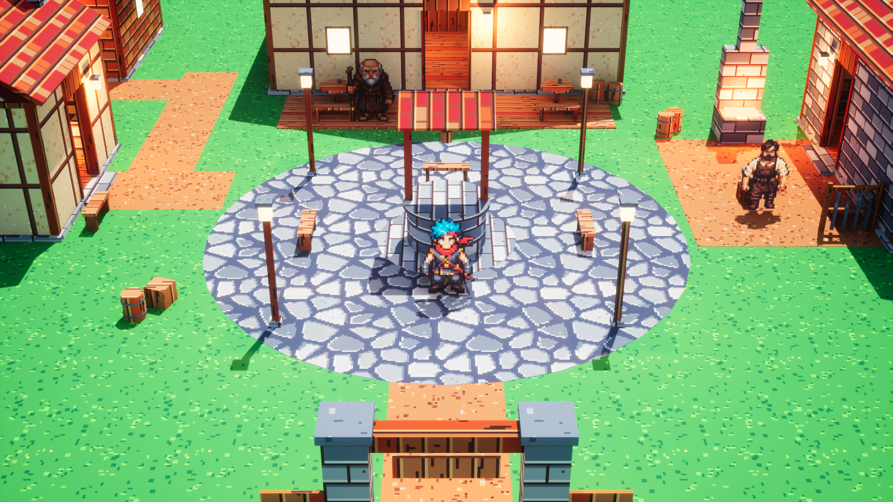
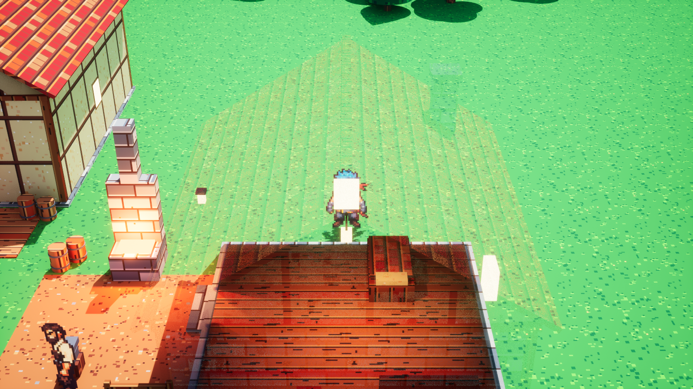

# Thornwick

### A village that remembers you.

An HD-2D living-village prototype built in Unreal Engine 5. Talk to villagers in free text, help with their work, and see
how memories, gossip and personal opinions shape your next encounter.

**Status: early development.** The current prototype has two active villagers and a playable foundation for conversation,
daily life and social consequences. Visuals and dialogue reliability are still being refined.

## What happens in the village?

You arrive as a stranger. Garrick, the blacksmith, and Elder Maren have their own routines, temperaments and concerns.
What you say can make one grateful, hurt, wary or angry. What you do can become a memory—and something another villager
hears about later.

The aim is a small place whose people feel like they have lives beyond the conversation box.

## Working in the prototype

- **Free-text conversations** powered by a local language model.
- **Persistent memories and gossip:** villagers remember interactions and pass news between themselves.
- **Daily lives:** work, meals, sleep, moods, and reactions that differ with personality and relationships.
- **Beliefs about the player:** villagers reflect on memories overnight; their opinions influence later behaviour.
- **Initiative:** villagers can approach the player, bring up earlier events, and end conversations themselves.
- **A small gameplay loop:** gathering, chores, trade, sleep and persistent saves.
- **An HD-2D world:** pixel-art characters in a lit 3D village, with a day/night cycle, enterable buildings and camera-aware
  building fades that keep the player visible.

## How it is being built

The project combines **Unreal Engine C++** with **local language-model inference through Ollama**. Game systems own world
state and mechanical outcomes; language models interpret player text and express the villagers' responses.

Personality, needs, mood and relationships drive general behaviour rules. The direction is to make NPC abilities
extensible, so new gameplay features can give villagers more freedom through a shared capability interface. That
interface is planned; it is not yet implemented.

Development uses deterministic rule tests, C++/Python parity checks, in-engine regression tests and model evaluations.
The evaluation system is being strengthened to check meaning and expected behaviour across varied conversations.

## Current focus

- Make dialogue consistently agree with current world facts and executable abilities.
- Turn accepted shared activities into real actions in the world.
- Improve conversation flow and evaluate a wider range of player behaviour.
- Develop richer relationships between villagers after the immediate playtest fixes.

These are development goals, rather than a list of finished features. The prototype still produces occasional incorrect
claims, and some requests cannot yet be carried out. There is no public playable release at this stage.

Recent work: keeping the player visible

Buildings now fade when they block the camera's view of the player, then restore when the player moves clear. Their walls
remain solid and continue casting shadows. Interior roof cutaways still work separately.

## About this repository

This is the public project showcase: an overview and selected development screenshots. The implementation repository
remains private. All screenshots show the actual prototype; this page will evolve as the game develops.
