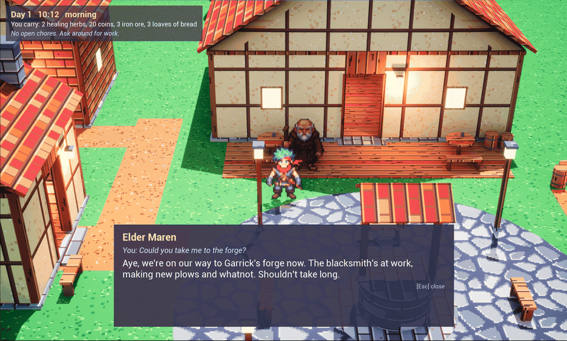
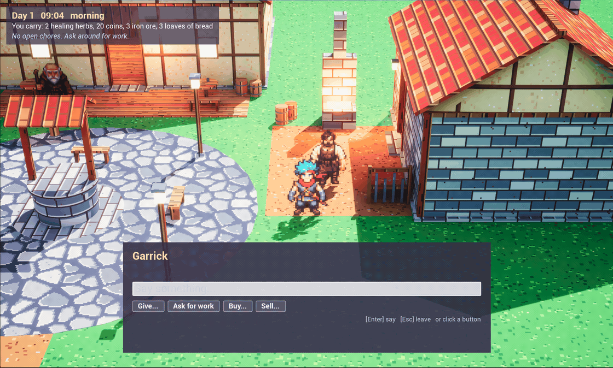
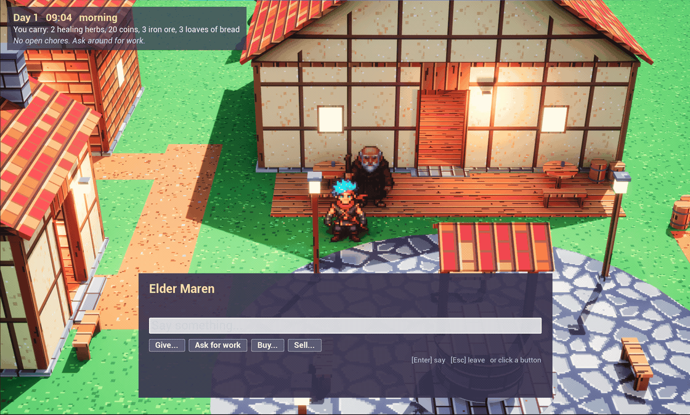
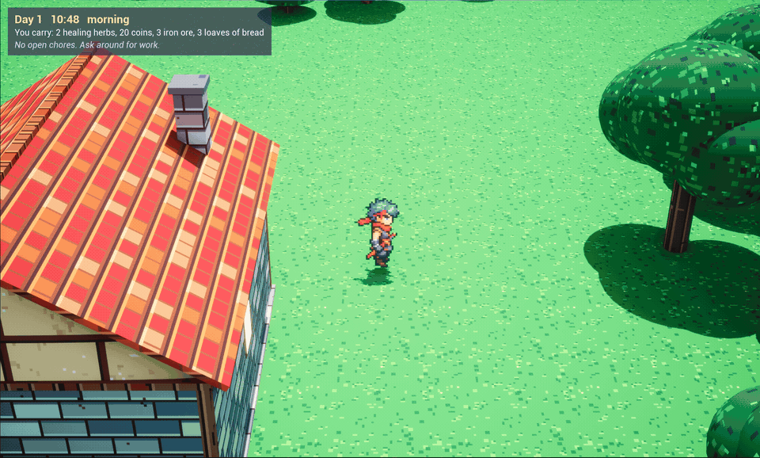
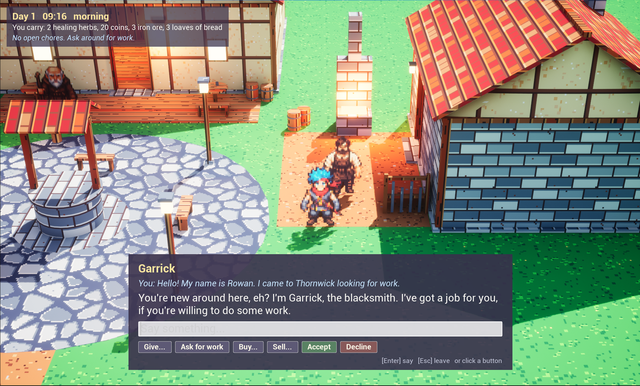
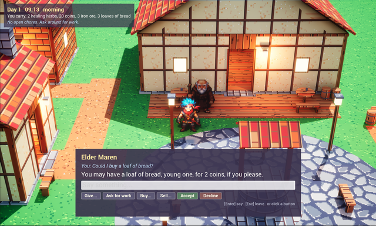

# Thornwick

### A village that remembers you.

**VillageSim** is an HD-2D living-village prototype built in Unreal Engine 5: pixel-art characters in a lit 3D world,
with free-text conversations powered by a local language model.

**In development · C++ · Unreal Engine 5 · Python · Ollama**

Two villagers live here today: Garrick the blacksmith and Elder Maren. Their routines, needs, moods and memories shape
how they respond to the player. The goal is a small village whose people have lives beyond the conversation box.

## Watch the prototype

### Ask for directions, then follow the villager

Maren accepts a request to show the way to the forge, sets off, and leads the player there. This is a walking excerpt;
the full capture includes the request and arrival. The game decides whether a villager agrees to help.

[Full guide capture — MP4](media/guide.mp4)

### Talk in your own words

The player introduces themselves as Rowan and says they are looking for work. Garrick responds through the local model,
and the game's job offer appears with Accept and Decline buttons. Dialogue is generated, while the job and its outcomes
come from game state.

[Full conversation capture — MP4](media/conversation.mp4)

### Agree on a price, then make the trade

Maren quotes one loaf of bread at **2 coins**. Accepting the quote transfers the bread and updates the player's inventory
and coins in the HUD. The transaction is executed and verified by the game.

[Full purchase capture — MP4](media/trade.mp4)

### Stay visible behind buildings

Building geometry fades when it blocks the camera's view of the player. Collision remains solid, and buildings restore
their materials when clear. Interior cutaways are handled separately.

[Full building-fade capture — MP4](media/building-fade.mp4)

About these captures

These are actual development-build captures, recorded on November 17, 2026. A temporary village save and development
controls stage locations, time of day and player input. Dialogue comes from the local Llama 3.2 3B model; it is not
written over the footage. NPC movement, job offers and inventory transfers run through the game's existing systems.

GIFs are excerpts at recorded speed; the MP4s retain the full takes. Editor chrome is cropped out. Capture overhead can
reduce the frame rate, particularly in the dialogue clips. These recordings demonstrate selected working interactions,
not a finished game or a guarantee that every conversation succeeds.

## Screenshots

Click an image to view it at full resolution.

| A conversation with Garrick | A purchase quote from Maren |
|:---:|:---:|
|  |  |
| **Inside the tavern** | **Evening in the village** |
|  |  |

More stills: [completed purchase](media/trade-complete.png) · [the forge yard](media/forge-yard.png) ·
[building fade](media/building-fade.png).

## What is working today?

- **Free-text conversations** with two villagers, running through a local model.
- **Persistent memories and gossip:** interactions can be remembered and passed between villagers.
- **Daily lives:** work, meals, sleep, moods and reactions influenced by personality and relationships.
- **Overnight reflection:** villagers form beliefs about the player from their memories.
- **Initiative:** villagers can approach the player, bring up past events and end conversations themselves.
- **A small gameplay loop:** gathering, chores, trade, sleep and persistent saves.
- **Basic shared activities:** including the guided walk shown above.
- **An HD-2D village:** day/night lighting, enterable buildings, interior cutaways and camera-aware building fades.

## Engineering behind it

**The game owns the state.** Unreal C++ systems control trust, inventory, quests and simulation outcomes. Local language
models interpret player text and phrase responses. Structured outputs and grounding guards constrain replies, but do
not yet catch every semantic mistake.

**Behaviour comes from general rules.** Personality, values, needs, mood and history influence choices. The direction is
greater NPC freedom through an extensible capability interface, with the game validating proposed actions. That broader
interface is still planned; the shared activities shown here are an initial implementation.

**Persistence and evaluation are part of the prototype.** Saves use journaled multi-file transactions with interruption
recovery. Development includes deterministic rule tests, C++/Python parity checks, in-engine UI/regression tests and model
behaviour evaluations. Four local models were compared across 1,252 conversation turns, measuring behaviour, latency and
GPU memory; the smaller baseline was retained because the larger models did not establish an overall quality win.

## What still needs work?

This is an early prototype with **two active villagers**, unfinished art and interaction UI, and no public playable
release yet. Dialogue can still confuse facts, the source of a memory, or promises beyond the NPC's actual abilities.
The existing evaluations also have semantic blind spots.

Current work focuses on keeping dialogue consistent with current world state, making more accepted requests executable,
and evaluating meaning across varied player behaviour. Richer relationships between villagers come after those basics.

## About this repository

This is the public showcase for VillageSim / Thornwick. It contains selected gameplay captures and project notes.
The implementation repository remains private.
